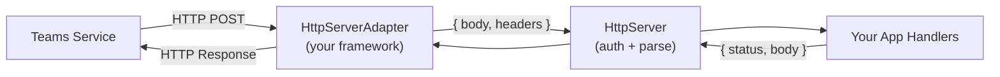

# Self-Managing Your Server

By default, `app.start()` spins up an HTTP server, registers the Teams endpoint, and manages the full lifecycle for you. Under the hood, the SDK uses [Express](https://expressjs.com/) as its built-in HTTP framework. But if you need to self-manage your server — because you have an existing app, need custom server configuration (TLS, workers, middleware), or use a different HTTP framework — the SDK supports that through the `HttpServerAdapter` interface.

## How It Works

The SDK splits HTTP handling into two layers:

- **HttpServer** handles Teams protocol concerns: JWT authentication, activity parsing, and routing to your handlers.
- **HttpServerAdapter** handles framework concerns: translating between your HTTP framework's request/response model and the SDK's pure handler pattern.



The adapter interface is intentionally simple — implement `registerRoute` and the SDK handles the rest.

## The Adapter Interface

```typescript
interface IHttpServerAdapter {
  registerRoute(method: HttpMethod, path: string, handler: HttpRouteHandler): void;
  serveStatic?(path: string, directory: string): void;
  start?(port: number): Promise<void>;
  stop?(): Promise<void>;
}

type HttpRouteHandler = (request: { body: unknown; headers: Record<string, string | string[]> })
  => Promise<{ status: number; body?: unknown }>;
```

- **`registerRoute`** — Required. Routes are registered dynamically (`/api/messages`, `/api/functions/name`, etc.).
- **`serveStatic`** — Optional. Only needed for tabs or static pages.
- **`start` / `stop`** — Optional. Omit when you manage the server lifecycle yourself.

## Self-Managing Your Server

To add Teams to an existing server:

1. Create your server with your own routes and middleware.
2. Wrap it in an adapter (or use the built-in one with your server instance).
3. Call `app.initialize()` — this registers the Teams routes on your server. Do **not** call `app.start()`.
4. Start the server yourself.

```typescript

// 1. Create your Express app with your own routes
const expressApp = express();
const httpServer = http.createServer(expressApp);

expressApp.get('/health', (_req, res) => {
  res.json({ status: 'healthy' });
});

// 2. Wrap your Express app, not the http.Server (avoids a duplicate listener crash)
const adapter = new ExpressAdapter(expressApp);

// 3. Create the Teams app with the adapter
const app = new App({ httpServerAdapter: adapter });

app.on('message', async ({ send, activity }) => {
  await send(`Echo: ${activity.text}`);
});

// 4. Initialize — registers /api/messages on your Express app (does NOT start a server)
await app.initialize();

// 5. Start the server yourself
httpServer.listen(3978, () => console.log('Server ready on http://localhost:3978'));
```

> **Note:** `app.initialize()` runs each plugin's `onInit` hook but not its `onStart` hook —
> `onStart` only fires from `app.start()`. When you take over the HTTP lifecycle with a custom
> adapter, plugins that do their setup in `onStart` won't run. If you're using such a plugin,
> either call `app.start()` (and let it manage the server) or invoke that plugin's `onStart`
> yourself after `app.initialize()`:
>
> ```ts
> await app.initialize();
> await myPlugin.onStart({ port: 3978 });
> ```

> See the full [Express adapter example](https://github.com/microsoft/teams.ts/tree/main/examples/http-adapters/express)

## Using a Different Framework

If you use a framework other than the built-in default, implement the adapter interface for your framework. The core work is in `registerRoute` — translate incoming requests to ` body, headers `, call the handler, and write the response back. Since you manage the server lifecycle yourself, `start`/`stop` aren't needed. And `serveStatic` is only required if you serve tabs or static pages.

Here is a Restify adapter — only `registerRoute` is needed:

```typescript

class RestifyAdapter implements IHttpServerAdapter {
  constructor(private server: restify.Server) {
    this.server.use(restify.plugins.bodyParser());
  }

  registerRoute(method: HttpMethod, path: string, handler: HttpRouteHandler): void {
    // Teams only sends POST requests to your bot endpoint
    assert(method === 'POST', `Unsupported method: ${method}`);
    this.server.post(path, async (req: restify.Request, res: restify.Response) => {
      const response = await handler({
        body: req.body,
        headers: req.headers as Record<string, string | string[]>,
      });
      res.send(response.status, response.body);
    });
  }
}
```

Usage:

```typescript
const server = restify.createServer();
const adapter = new RestifyAdapter(server);
const app = new App({ httpServerAdapter: adapter });
await app.initialize();
server.listen(3978);
```

> See the full implementation: [Restify adapter example](https://github.com/microsoft/teams.ts/tree/main/examples/http-adapters/restify)
